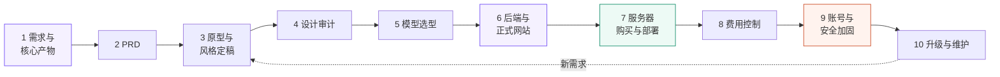
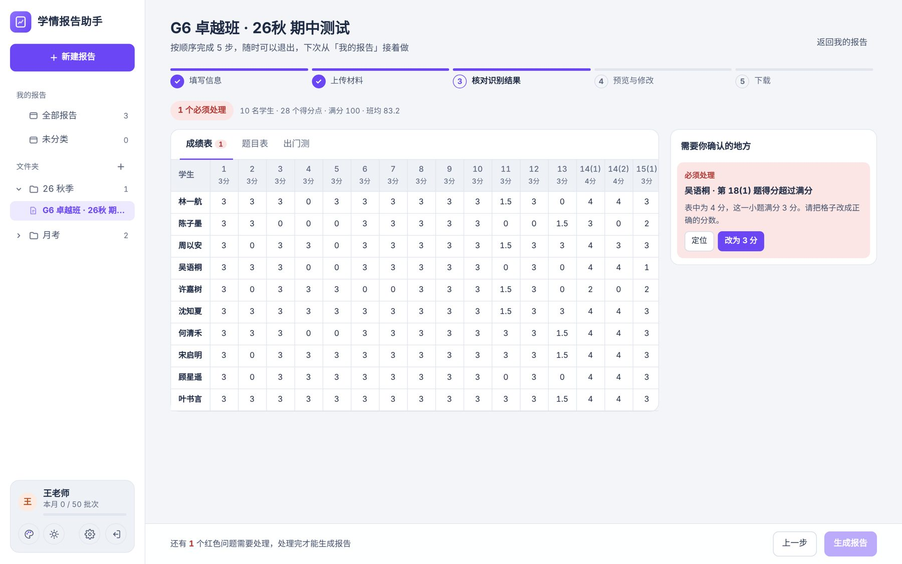
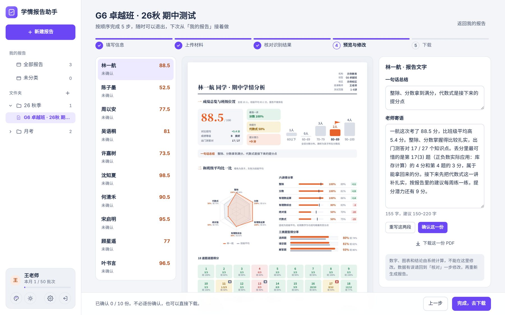
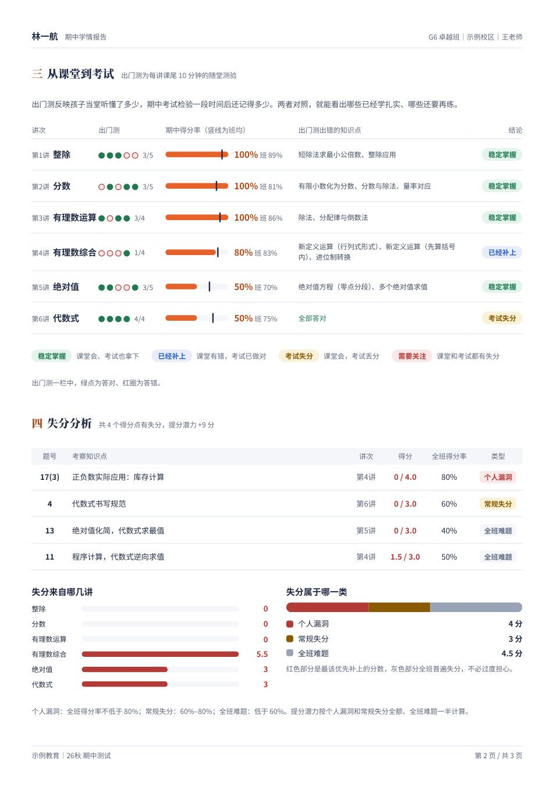

<div align="center">

# AI Product Builder

**一个让产品经理和 AI 一起，把产品从想法做到上线的 Skill**

需求 → PRD → 原型 → 正式网站 → 服务器部署 → 安全加固 → 持续迭代

[](./SKILL.md)
[](#-十个阶段)
[](./case-study/README.md)
[](./LICENSE)


<sub>用这套流程做出来并部署上线的产品：学情报告助手（截图中的机构、老师、学生均为虚构示例）</sub>

</div>

---

## 这是什么

`AI Product Builder` 是一个写给 AI 助手（Claude 等）的 **Skill**，也就是一份结构化的工作说明书。AI 加载它之后，会按一套固定的方法，陪一位**不写代码的产品经理**，把一个业务想法一步步做成能在公网访问的产品。

它不是空谈的方法论。这套流程是从一个**已经上线的真实项目**里提炼出来的：

> **学情报告助手**：教培机构的老师上传试卷、逐题成绩表和课堂测验记录，系统自动核对数据，为全班每位学生生成一份家长看得懂的 3 页学情报告（PDF）。
> 业务目标是用专业、可信的反馈提升家长续费率。
>
> → [查看完整案例](./case-study/README.md)　·　→ [产品源代码：AI-report-assistant](https://github.com/yezhu-aipm/ai-report-assistant)

## 为什么做这个 Skill

用 AI 做产品，最常见的问题不是"AI 写不出代码"，而是这几种：

| 常见问题 | 这个 Skill 的做法 |
|---|---|
| AI 自作主张，改了不该改的地方 | **先列清单、用户拍板，再动手**。审计、新功能、安全措施都先编号列出来，由人勾选 |
| 原型很漂亮，做不成真产品 | 原型和正式网站**沿用同一套页面结构和交互**，后端按原型的流程来设计 |
| 做出来了，不会部署 | 从买服务器到开端口、上传、安装、填密钥，**一步一个截图地带着做** |
| 上线后被人刷接口、花冒了钱 | 把**邀请码、验证码、登录锁定、限流、费用预警**都写进标准流程 |
| 换一次需求就要推倒重来 | 安装脚本可以**重复运行**，升级不丢数据；数据库字段会自动补齐 |
| AI 生成的数字不可信 | **数字由程序按规则计算，文字交给大模型写**，同样的输入永远得到同样的数字 |

## 🧭 十个阶段



| # | 阶段 | 做什么 | 交付物 | 需要人来拍板 |
|---|---|---|---|---|
| 1 | 需求与核心产物 | 弄清用户、输入、输出、业务目标；**先把最终产物做出来** | 固定的产物模板 | 产物结构 |
| 2 | PRD | 流程、功能分级、计算规则、校验规则、不做什么 | 可分享的文档 | 范围与优先级 |
| 3 | 原型与风格 | 可点击的单文件原型；3～4 套风格并排对比 | 原型链接 | 风格与交互 |
| 4 | 设计审计 | 可访问性、对比度、手机适配、空状态等 | 编号的问题清单 | 改哪几项 |
| 5 | 模型选型 | 选国内的、兼容 OpenAI 接口的模型；换模型只改配置 | 接入方案 | 选哪家、预算 |
| 6 | 后端与正式网站 | FastAPI + SQLite + React；规则计算和大模型写作分开 | 发布包 + 一键安装脚本 | — |
| 7 | 部署 | 云服务器选购、安全组、网页终端、不回显地填密钥 | 公网可访问的网站 | 机型、地域 |
| 8 | 费用控制 | 消费预警、余额预警，账户只放小额余额 | 预警配置 | 阈值 |
| 9 | 安全加固 | 邀请码、验证码、登录锁定、两层限流、防 SSH 爆破、每日备份 | 新版发布包 | 要哪些措施 |
| 10 | 升级维护 | 可重复运行的安装脚本、自动补数据库字段、看日志排错 | 一行升级命令 | — |

每个阶段的具体做法、命令和检查点，都写在 [`SKILL.md`](./SKILL.md) 里。

## 🤝 八条协作规则

这是整个 Skill 里最重要的部分，决定了 AI 是"可靠的合作者"还是"失控的执行者"。

1. **先列清单，用户拍板后再动手**。用户说"其他的不改"，就一处都不多改。
2. **说人话**：先给结论，再分步骤，再说注意事项；对比类问题用表格。
3. **一步一步带，看截图确认**：每一步都说清"做完应该看到什么"，并提前说好遇到报错怎么办。
4. **密码和密钥绝不经过对话**：密钥只填在服务器上，而且用不回显的方式输入。
5. **示例数据一律用虚构的**，不出现任何真实学生的信息。
6. **诚实交代没验证过的部分**，自己说错了要直接认。
7. **能自己查的不问用户**，只把真正需要人决定的事交给人。
8. **控制成本**：凡是涉及花钱的，先说清楚价格和续费价。

## 📦 仓库结构

```
ai-product-builder/
├── SKILL.md                      # Skill 正文（AI 读取的就是这个文件）
├── references/                   # 各阶段的模板和清单，按需取用
│   ├── prd-template.md           #   PRD 模板
│   ├── design-audit-checklist.md #   设计审计清单
│   ├── model-selection.md        #   国内大模型选型与接入
│   ├── deploy-aliyun.md          #   阿里云从购买到上线的手册
│   ├── cost-control.md           #   费用预警设置
│   ├── security-checklist.md     #   账号与安全加固清单
│   └── pitfalls.md               #   实战中踩过的坑
├── templates/                    # 可以直接拿去改的部署文件
│   ├── install.sh                #   可重复运行的一键安装 / 升级脚本
│   ├── backup.sh                 #   每日备份脚本
│   ├── nginx-ip.conf             #   用 IP 访问的 Nginx 配置（含限流）
│   └── env.example               #   配置文件模板
├── case-study/                   # 实战案例：学情报告助手
│   ├── README.md
│   └── images/
├── CHANGELOG.md
└── LICENSE
```

## 🚀 怎么使用

**在 Claude 里用**
1. 把整个文件夹作为一个 Skill 添加进去（核心是 `SKILL.md`）。
2. 之后直接对 Claude 说："我想做一个 XX 工具""继续做产品""把原型变成正式网站""帮我部署上线"，它就会按这套流程来。

**在其他 AI 工具里用**
把 `SKILL.md` 的内容作为系统提示，或者放进项目说明里；用到某个阶段时，再把 `references/` 里对应的文件一起提供给它。

**开场白示例**
```
我是一名产品经理，想给 [用户] 做一个 [工具]，解决 [问题]，业务目标是 [目标]。
请按 ai-product-builder 的流程，从第 1 阶段开始带我做。
```

## 🖼 案例一览

<table>
<tr>
<td width="50%"><br><sub><b>数据核对</b>：超出满分、总分对不上的地方会被标红拦下，点一下就能改正</sub></td>
<td width="50%"><br><sub><b>逐份预览</b>：数字由系统计算，老师只看一句话总结和寄语，可以改写或重写</sub></td>
</tr>
<tr>
<td><br><sub><b>生成的报告</b>：成绩总览、班级位置、各讲得分率和雷达图</sub></td>
<td><br><sub><b>课堂对照考试</b>：把出门测和期中成绩放在一起看，标出失分类型和提分潜力</sub></td>
</tr>
</table>

👉 完整的过程、关键决策和技术方案，请看 [case-study/README.md](./case-study/README.md)。

## 适用范围

- **适合**：产品经理、运营、创业者，有清晰的业务问题，想自己做出一个能用的小产品。用户量在几十到几百人，单台服务器就够用。
- **技术栈默认**：Python FastAPI、SQLite、React（Vite）、Nginx、Ubuntu、国内云服务器、国内大模型。
- **不适合**：需要高并发、多机部署、严格合规审计的企业级系统。这类系统应该交给工程团队。

## License

[MIT](./LICENSE)
