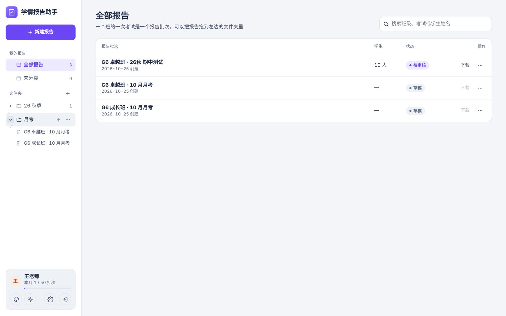
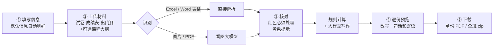
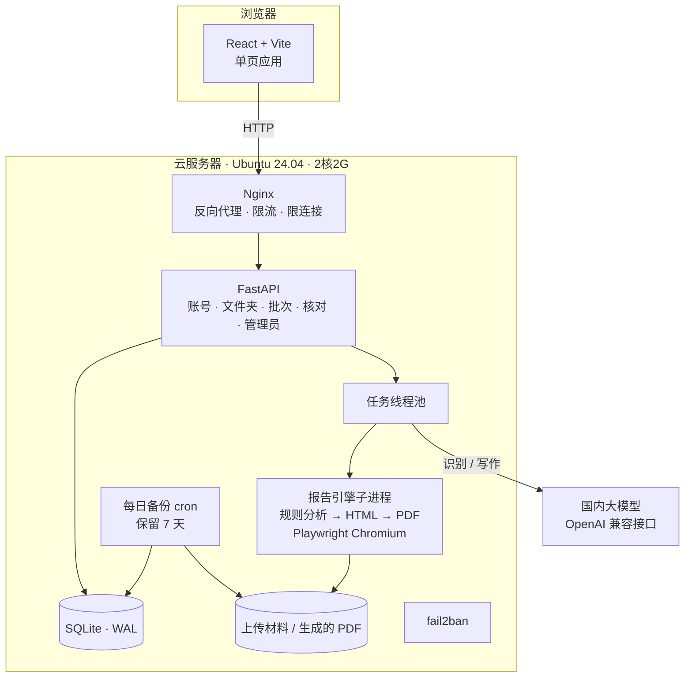
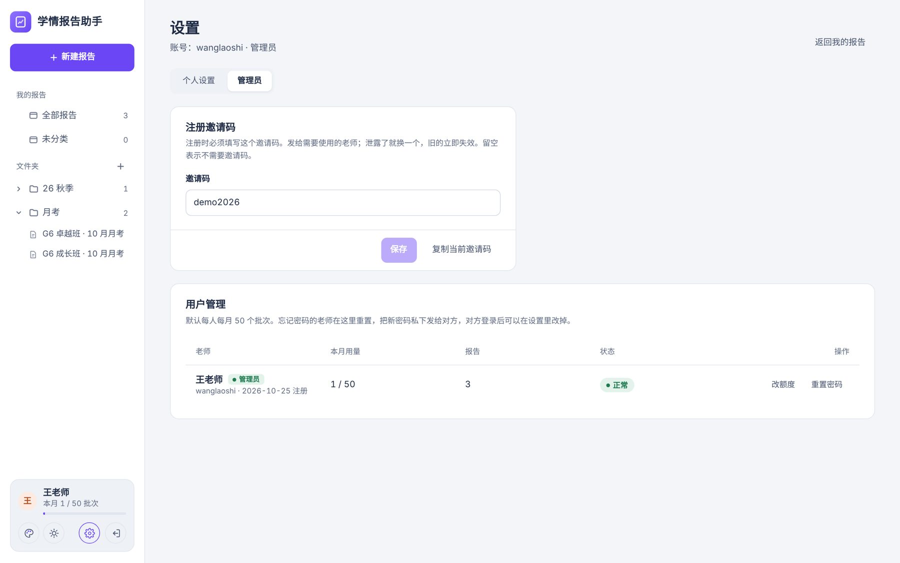
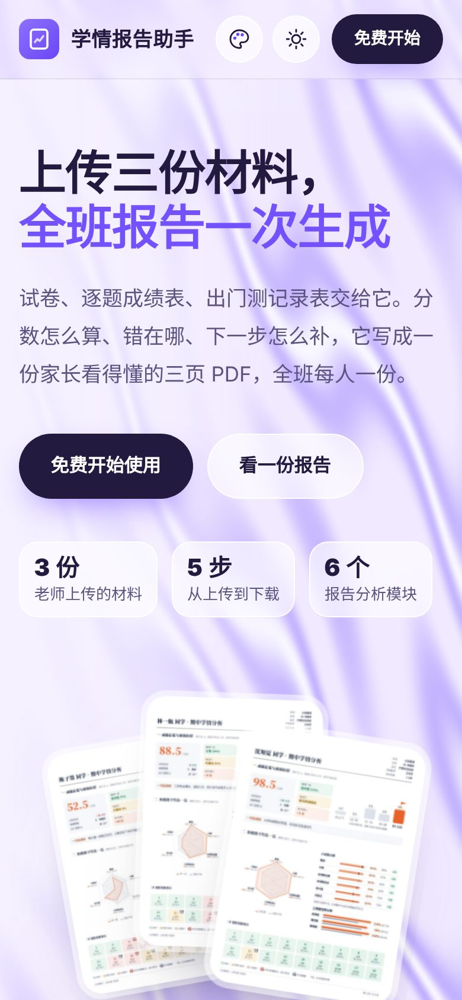

# 实战案例：学情报告助手

> 一位教培机构的 AI 产品经理（不写代码），和 AI 一起按 `ai-product-builder` 的 10 个阶段，从一份报告样张开始，做出了一个能在公网访问的多用户网站。
>
> 截图中的机构、校区、老师、学生和成绩**全部是虚构的示例数据**。
>
> 📦 产品源代码与安装包：**[yezhu-aipm/ai-report-assistant](https://github.com/yezhu-aipm/ai-report-assistant)**

---

## 1. 背景与目标

| | |
|---|---|
| **用户** | 教培机构的任课老师 |
| **场景** | 期中、期末、月考之后，要给每位家长一份像样的学情反馈 |
| **现状** | 老师手工完成：逐题算得分率 → 翻出门测记录逐讲对照 → 判断每个孩子丢分的原因 → 写建议和寄语 → 作图排版 → 发出前再核一遍数字。**每个学生都要重复一遍** |
| **业务目标** | 用专业、可信、家长看得懂的反馈，提升家长的**续费意愿** |
| **产品目标** | 老师只上传 3 份材料、只核对系统标出的几处问题，就能下载全班报告 |

## 2. 关键决策

### 决策一：先定产物，再做工具
第一步没有写任何功能，而是先做出一份**写死数据的 3 页报告样张**，跟业务方反复确认结构：
- **第 1 页**：成绩总览、班级位置、六讲得分率、雷达图、逐题得分。
- **第 2 页**：课堂对照考试、失分分析。
- **第 3 页**：学习建议、课程规划、老师寄语。

产物定下来之后，"要识别什么、要算什么、要写什么"就都清楚了。

  

### 决策二：数字由程序算，文字由大模型写
| 由程序按固定规则算 | 由大模型写 |
|---|---|
| 班均、得分率、分数段分布 | 一句话总结 |
| 失分分类：全班得分率 ≥80% 算个人漏洞，60–80% 算常规失分，<60% 算全班难题 | 老师寄语 |
| 提分潜力 = 个人漏洞 + 常规失分 + 全班难题 × 0.5 | 学习建议的措辞 |
| 课堂掌握状态：稳定掌握 / 已经补上 / 考试失分 / 需要关注 | |

这样，**同样的成绩永远得到同样的报告数字**，家长和老师都能追溯每个数是怎么来的；大模型只负责把结论写成家长听得懂的话。

### 决策三：错误数据进不了报告
识别完成后先进入"核对"这一步。分两个等级：
- **红色必须处理**：比如超出满分、总分对不上、名单不一致、讲次缺失。
- **黄色提示**：比如识别没把握、得分偏低、多出来的学生。

每个问题都带一键修正按钮，比如"改为满分""以系统合计为准"。红色问题全部处理完，才能生成报告。

### 决策四：交互对齐用户熟悉的产品
老师们平时用飞书，所以文件夹树完全按飞书的习惯来做：
- 鼠标悬停时出现 **+** 和 **⋯**；
- 可以行内重命名；
- 报告可以拖进文件夹，也可以在文件夹里拖动排序；
- ⋯ 菜单里有"创建副本 / 移动到 / 删除"；
- 当前打开的是哪份报告，左侧栏就高亮哪一条。

### 决策五：风格先并排对比，再定稿
先做了 4 套首页风格样张并排展示。选定"丝绸流光背景 + 三张报告卡片叠放"之后，又做了这些调整：
- 卡片跟随鼠标倾斜，鼠标移上去时展开；
- 加了换颜色和白天/夜间两个按钮；
- 卡顿或者显得廉价的动效，比如鼠标拖拽时的丝绸形变，直接去掉。

### 决策六：选国内大模型，只靠配置切换
- 代码只认 `LLM_BASE_URL`、`LLM_API_KEY`、`LLM_VISION_MODEL`、`LLM_TEXT_MODEL` 这四个配置。通义千问、DeepSeek 等兼容 OpenAI 接口的模型都能直接换。
- 没配密钥时，网站自动进入**演示模式**：直接读取 Excel 和 Word 表格，用模板生成文字。不花钱也能把整个流程跑通。

## 3. 产品流程

## 4. 技术方案

| 层 | 选型 | 为什么 |
|---|---|---|
| 前端 | React 18 + Vite，hash 路由 | 打包后交给后端统一提供，部署时只跑一个服务 |
| 后端 | FastAPI + SQLite（WAL 模式） | 单机就够用；不用另外维护数据库 |
| 任务 | 线程池 + 子进程 | 生成 PDF 又慢又占内存，放到子进程里跑，不会拖垮主服务 |
| PDF | Playwright Chromium + pymupdf | 报告先用 HTML 排版再转 PDF，同时生成预览图 |
| 登录 | scrypt 加盐哈希 + HttpOnly Cookie | 没有用任何第三方登录服务 |
| 部署 | systemd + Nginx + 一键安装脚本 | 安装脚本可以重复运行，升级不丢数据 |

代码规模：后端（Python）约 2,200 行，前端（React / CSS）约 1,800 行，40 多个接口。

## 5. 上线与运维

| 事项 | 做法 |
|---|---|
| 服务器 | 阿里云 ECS e 实例，2核2G，固定带宽 3M，续费同价；系统选 Ubuntu 24.04 |
| 访问 | 先用公网 IP 访问（不需要备案），以后再上域名和 HTTPS |
| 小内存适配 | 安装脚本检测到内存小于 3G 时，自动加 2G 虚拟内存，并设置一次只处理一个任务 |
| 国内网络 | pip 用阿里云镜像，Playwright 用 npmmirror 镜像 |
| 密钥 | 用 `read -s` 在服务器上输入，不显示、不经过对话；填完再做长度检查和一次连通测试 |
| 费用 | 设置高额消费预警和可用额度预警；账户只放小额余额，作为真正的封顶 |

## 6. 账号与安全

| 类别 | 功能 |
|---|---|
| 注册 | 邀请码（管理员可以在网页上更换）、图形验证码 |
| 登录 | 同一个账号连续错 5 次锁 15 分钟；同一个 IP 的上限更宽，因为一个校区可能共用一个出口 IP；输错一次后才出现验证码 |
| 限流 | 应用里一层，Nginx 的 `limit_req` / `limit_conn` 再一层 |
| 服务器 | fail2ban 防 SSH 爆破，并放行云厂商网页终端用的内网段 |
| 数据 | 每天凌晨备份，用 `sqlite3 .backup` 在运行中安全备份，保留 7 天 |
| 个人设置 | 修改称呼和密码、本月用量、新建报告的默认信息、退出其他所有设备、注销账号 |
| 管理员 | 用户列表、重置密码（随机密码只显示一次）、停用账号、单独调整额度 |

 

## 7. 做对了什么、学到了什么

1. **先定产物**，后面的工作都有了明确的目标，大大减少了返工。
2. **把 AI 的不确定性关进笼子**：AI 只负责读材料、写文字；所有数字和结论都由程序按规则算，再经过核对这一步，错误数据进不了报告。
3. **每个方向性的改动都由人拍板**。AI 先列清单，人勾选后再执行，很少出现"改多了"的情况。
4. **从第一天就为非程序员的运维设计**：一键安装、可重复运行的升级、看截图排错、不回显地填密钥。
5. **诚实交代**：没在真实环境验证过的部分，交付时单独列出来，比如真实大模型识别的准确率、Docker 部署。

## 8. 接下来

- 绑定域名、完成 ICP 备案，开启 HTTPS。
- 用更多真实试卷验证识别准确率，并据此调整提示词。
- 增加学科，比如英语和物理。
- 增加报告分享链接，家长用手机直接打开。

